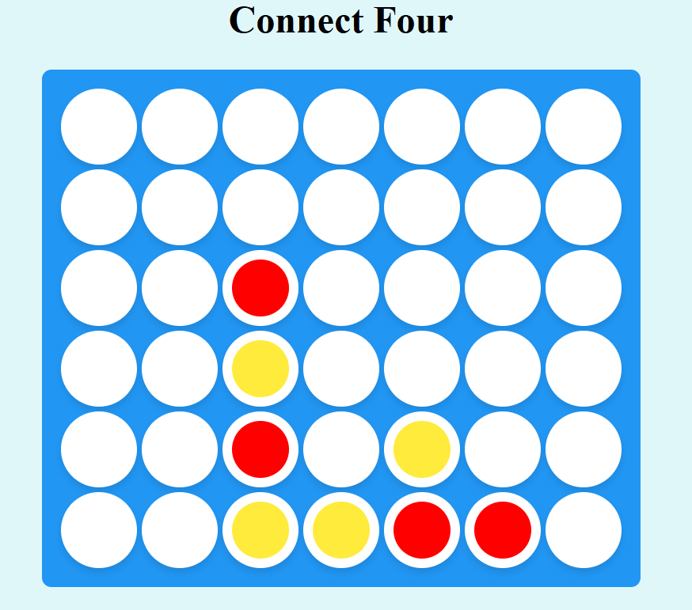

# 🎮 Puissance 4 — Connect Four

<p align="center">
  <strong>Un jeu de stratégie développé dans le cadre du module Intelligence Artificielle.</strong>
</p>

---

## 📌 Présentation du projet

Ce projet consiste à développer le jeu **Puissance 4**, un jeu de stratégie dans lequel deux joueurs s'affrontent sur un plateau composé de 6 lignes et 7 colonnes.

Le but est d'aligner quatre jetons de la même couleur horizontalement, verticalement ou en diagonale avant son adversaire.

Réalisé dans le cadre du module **Intelligence Artificielle**, ce projet permet de mettre en pratique des concepts de programmation et de logique appliqués aux jeux.

## ✨ Fonctionnalités

- 🎯 Plateau de jeu de 6 lignes et 7 colonnes.
- 🔴🟡 Placement des jetons dans les colonnes.
- 🏆 Détection des alignements gagnants.
- 🤝 Gestion des tours de jeu.
- 🎨 Interface graphique simple et agréable.

## 🖥️ Aperçu du jeu



## 🎲 Règles du jeu

1. Chaque joueur choisit une colonne pour placer son jeton.
2. Le jeton tombe sur la première case disponible en partant du bas.
3. Le premier joueur qui aligne quatre jetons horizontalement, verticalement ou en diagonale remporte la partie.
4. Si le plateau est rempli sans gagnant, la partie se termine par un match nul.

## 🛠️ Technologies utilisées

- **Langage :** à compléter.
- **Interface graphique :** à compléter.
- **Intelligence artificielle :** algorithme utilisé à préciser, si applicable.

## 🚀 Installation

Clonez le dépôt GitHub :

```bash
git clone URL_DE_VOTRE_DEPOT
```

Ouvrez ensuite le projet dans votre environnement de développement et suivez les instructions nécessaires à son exécution.

## 🎓 Contexte académique

Projet universitaire réalisé dans le cadre du module **Intelligence Artificielle**, autour de la programmation et de la résolution de problèmes dans un environnement de jeu.

---

*Développé dans le cadre d'un projet universitaire.*
